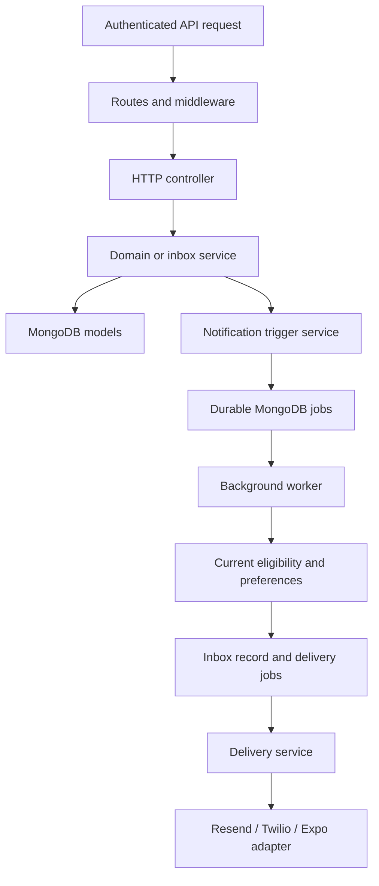

# General-user notification backend

This implements all ten notification types in the backend. The later [frontend and event ratings phase](notifications-and-event-ratings.md) connects the inbox/preferences screens and rating actions. Provider accounts, live external delivery, native permission prompts, and push-token registration remain on hold. No live database writes, provider sends, server starts, tests, typechecks, lint, or syntax checks were run during implementation. Review was limited to source and diffs.

## File workflow



- **Routes** declare endpoints and attach authentication/no-cache middleware.
- **Controllers** extract HTTP input, call services, and format HTTP responses/errors.
- **Domain services** apply ownership and business rules. Their existing account-fenced MongoDB transaction also records notification jobs through `triggerService`.
- **Models** define collections, validation, indexes, and persistence. Services use these models; they never receive Express `req` or `res`.
- **The worker** claims due jobs with leases, checks current eligibility/preferences, and atomically creates the inbox record and channel/device delivery jobs. Fanout jobs expand a committed audience snapshot in chunks.
- **The delivery service** checks current preferences, account state, event state, and destination ownership again. It then calls a provider outside every MongoDB transaction.
- **Provider adapters** contain only transport/provider mapping. They do not decide recipients, event eligibility, or HTTP responses for app clients.

Reading the inbox does not pass through delivery adapters. A background reminder does not pass through an HTTP controller. Shared policies/templates are reusable by services and workers.

## Notification rules

| Type | Trigger and recipient |
| --- | --- |
| `REGISTRATION_CONFIRMED` | Attending changes from false to true; the registering user. |
| `REGISTRATION_CANCELLED` | Attending changes from true to false; that user. |
| `EVENT_STARTS_24H` | 24 hours before start; currently attending users. |
| `EVENT_STARTS_1H` | 1 hour before start; currently attending users. |
| `EVENT_CANCELLED` | Host cancels; interested or attending users, once per user. |
| `EVENT_DATETIME_CHANGED` | Start, end, or timezone changes; interested or attending users. |
| `EVENT_LOCATION_CHANGED` | Venue/address/place ID/coordinates change; interested or attending users. |
| `SAVED_EVENT_REGISTRATION_CLOSING` | 24 hours before registration closes; interested users who are not attending. |
| `FOLLOWED_ORGANIZER_NEW_EVENT` | Organizer creates an event; users already following that organizer. |
| `RATE_ATTENDED_EVENT` | 1 hour after end; eligible attending users who have not rated yet. New records open the rating form with a `RATE_EVENT` action. |

Attending is the existing registration flag; interested is the existing saved flag. A follow is a directed organizer subscription, separate from friendship. Following now does not backfill previous event announcements.

Registration closes at `registrationClosesAt` if the host supplied an earlier deadline, otherwise at `startsAt`. Deadlines cannot exceed start time. New registrations are blocked at the cutoff. An existing registration can still be cancelled before the event ends. Past and host-cancelled selections are read-only.

`POST /api/events/:id/cancel` is owner-only, accepts an optional reason up to 500 characters, and retains event/selection history. Cancelled events leave discovery, remain accessible by their retained details, and cannot be edited or reactivated. Ended events cannot be cancelled. Account closure is not treated as an event cancellation; closed recipients/hosts are suppressed by eligibility checks.

Dates remain BSON/ISO instants with an event timezone. Human-readable notification dates use `MM/DD/YYYY` in that timezone.

## Collections

| Collection | Model | Purpose |
| --- | --- | --- |
| `notifications` | `Notification` | One occurrence per user: `userId`, `eventId`, `actorId`, `type`, `title`, `message`, safe `data`, `action`, chosen `channels`, `isRead`, `readAt`, unique `dedupeKey`, `occurredAt`, timestamps. |
| `notificationJobs` | `NotificationJob` | Durable notification/fanout/delivery/receipt jobs; unique key, due/expiry, payload, claim lease, attempts, state, safe error code, timestamps. |
| `notificationDeliveries` | `NotificationDelivery` | Per external channel/device outcome, provider message ID, attempt/acceptance/receipt timestamps, safe error code. |
| `pushDevices` | `PushDevice` | Owned Expo token registrations, installation/project/platform, active state, hidden token/hash, last seen time. |
| `organizerFollows` | `OrganizerFollow` | Unique user/organizer pair, active state, followed time. |
| `NotificationSettings` (existing) | `NotificationSettings` | Existing 19 choices plus global channels and optional per-type channel choices. |

Existing event/selection models gain cancellation/deadline/version fields and registration/save transition timestamps. Older records are interpreted with published status, zero generations, and registration closing at start. No historical registration confirmations are invented.

Normal backend startup initializes the new collections and indexes before accepting requests. This implementation did not connect to Atlas or migrate/rewrite existing records.

## Authenticated APIs

The logged-in session determines the user. Clients cannot submit another recipient ID or call a generic notification-send endpoint.

| Method and path | Input / result |
| --- | --- |
| `GET /api/notifications?limit=20&cursor=...` | Inbox records, newest first; `{notifications, nextCursor}`. Limit 1–100; opaque cursor. Only records that selected in-app appear. |
| `GET /api/notifications/unread-count` | `{unreadCount}` for the caller's in-app records. |
| `PATCH /api/notifications/:id/read` | `{ "read": true }` or false; `{notification}`. |
| `POST /api/notifications/read-all` | Empty body/object; `{updatedCount}`. |
| `GET /api/notifications/preferences` | `{settings, channels, typeChannels}`. |
| `PATCH /api/notifications/preferences` | Partial supported boolean settings/channels/type overrides; returns updated preferences. |
| `GET /api/notification-devices` | Caller-owned active device summaries; never returns tokens or hashes. |
| `POST /api/notification-devices` | `{token, installationId, projectId, platform}`; UUID installation/project and `android` or `ios`. Returns safe device summary. |
| `DELETE /api/notification-devices/:id` | Disable caller-owned device; 204. |
| `GET /api/organizer-follows` | Caller-owned active follows with public organizer information. |
| `POST /api/organizer-follows/:organizerId` | Follow an active account; empty body/object. No self-follow. |
| `DELETE /api/organizer-follows/:organizerId` | Unfollow; empty body/object; 204. |
| `POST /api/events/:id/cancel` | `{ "reason": "Optional reason" }`; existing event response wrapper. |

Existing create/update event endpoints accept optional `registrationClosesAt` as an offset-bearing ISO timestamp or `null`. Omitting it on edit preserves an explicit stored deadline. Moving start before that deadline is rejected until the host changes the deadline. `status`, cancellation fields, and notification generations cannot be set through ordinary event payloads.

Example preference update:

```json
{
  "channels": { "inApp": true, "push": true, "email": true, "sms": false },
  "typeChannels": {
    "EVENT_STARTS_1H": { "email": false, "push": true }
  }
}
```

Channel defaults are in-app on, push/email/SMS off. A type choice cannot override a disabled global channel. `emailMaster` and `phoneMaster` still gate email and SMS respectively. Existing attending reminder, saved-event email, and organizer-announcement flags also gate their relevant types. Other legacy settings remain stored for their existing/future features. The old settings endpoint retains its settings/contact response and now also includes channel/type choices. An empty object for a type resets that type to global choices.

Push registration requires the configured Expo project, allows up to ten active devices per user, replaces an installation's previous token, and transfers a re-registered token to the current user. Removing it or transferring ownership prevents pending deliveries to its previous user. Mobile logout should unregister that installation when frontend integration is added.

## Timing, retries, and delivery meaning

- Events/selections and their trigger jobs commit together. Duplicate requests do not create duplicate occurrences. A genuine cancel/re-register cycle has a new generation and may notify again.
- A bounded rotating scan repairs **future** reminder schedules after startup or event edits. It uses the same scheduler as live registrations. Due times already missed are not backfilled.
- Timed reminders expire after the configured polling grace (default two minutes). The worker checks exact event anchors and registration/save generations, suppressing stale schedules after edits/cancellation/unregistering. The backend/worker must be running for timely scheduling/delivery; long downtime intentionally loses stale reminders.
- Atomic job claims/leases allow multiple server processes to cooperate. Retries use backoff; configuration-disabled jobs remain resumable without consuming provider-attempt budgets.
- External delivery is rechecked against current user settings and current owned email/phone/device just before sending. A request already in flight cannot be recalled.
- Resend retries use a stable idempotency key and stored wording. Retries stop before the provider's 24-hour idempotency window expires. A changed sender/contact can cause an idempotency conflict, retained as `unknown` for provider review rather than a duplicate send.
- Ambiguous Twilio/Expo sends are retained as `unknown` for manual provider review; they are not automatically resent. A crash while sending is also treated conservatively. No automatic exactly-once delivery guarantee is claimed.
- Expo receipt polling starts about 15 minutes after acceptance and stops after 24 hours. Invalid tokens are disabled. An accepted ticket/receipt means a provider accepted it, not that a phone displayed it.
- Read/unread is an inbox state, separate from provider acceptance and delivery. No delivery-status callbacks/webhooks are included in this phase, so email/SMS provider acceptance is not labelled confirmed device delivery.
- Provider traffic and raw responses, credentials, destination contacts, and tokens are never logged by this notification implementation. The queue stores only sanitized failure codes.

## Configuration and activation

Use [`backend/.env.notifications.example`](../backend/.env.notifications.example) as a reference and copy selected settings into the existing `.env` yourself. The actual `.env` was not modified. No new npm dependencies are needed.

`npm start` connects to Atlas, initializes notification model indexes, starts the worker, then listens. Importing the Express app does not start a server or worker. SIGINT/SIGTERM stop new requests/claims, finish work already in progress, then disconnect Atlas.

| Variable | Default / use |
| --- | --- |
| `NOTIFICATIONS_WORKER_ENABLED` | `true`; set `false` to disable background work in that server process. |
| `NOTIFICATIONS_EXTERNAL_DELIVERY_ENABLED` | `false`; set `true` only when outbound channels are ready. In-app creation works independently. |
| `NOTIFICATIONS_POLL_MS` | `5000` (1,000–60,000); next poll follows the previous batch. |
| `NOTIFICATIONS_BATCH_SIZE` | `20` (1–100); jobs per poll. Reconciliation also uses a bounded batch. |
| `NOTIFICATIONS_LEASE_MS` | `120000` (60,000–600,000). |
| `NOTIFICATIONS_REMINDER_GRACE_MS` | `120000` (1,000–300,000). |
| `NOTIFICATIONS_MAX_ATTEMPTS` | `5` (1–10); transient send/job attempts. Configuration waits and receipt polling have separate handling. |
| `RESEND_API_KEY`, `NOTIFICATION_EMAIL_FROM` | Resend server key and verified sender. |
| `TWILIO_ACCOUNT_SID`, `TWILIO_AUTH_TOKEN` | Twilio server credentials. |
| `TWILIO_MESSAGING_SERVICE_SID` or `TWILIO_FROM_NUMBER` | Twilio Messaging Service or sender number. |
| `EXPO_PROJECT_ID`, `EXPO_ACCESS_TOKEN` | Expo project UUID and server access token. Enable Expo push access-token security. |

Email goes to the current account email. SMS uses the current account-profile phone converted to international `+` digits; absent/invalid contacts are skipped. Users must opt into external channels. Push additionally needs a real registered device token, platform push credentials, and later mobile permission/token handling. In-app notifications are stored for retrieval inside the app; push is what can appear outside the app, including on the lock screen when device permissions/settings permit it.

Provider references: [Resend send API](https://resend.com/docs/api-reference/emails/send-email), [Resend idempotency](https://resend.com/docs/dashboard/emails/idempotency-keys), [Twilio Messages API](https://www.twilio.com/docs/messaging/api/message-resource), [Expo send/receipt API](https://docs.expo.dev/push-notifications/sending-notifications/).

## Files created

| Files | Responsibility |
| --- | --- |
| `backend/.env.notifications.example` | Configuration reference with blank credentials and outbound delivery off. |
| `backend/src/constants/notificationTypes.js` | Shared types, channels, and provider names. |
| `backend/src/config/notifications.js` | Lazy worker/provider configuration. |
| `backend/src/models/Notification.js` | Inbox schema and deduplication index. |
| `backend/src/models/NotificationJob.js` | Durable job/lease schema. |
| `backend/src/models/NotificationDelivery.js` | Per-destination provider outcomes. |
| `backend/src/models/PushDevice.js` | Owned hidden Expo tokens. |
| `backend/src/models/OrganizerFollow.js` | Directed organizer-follow records. |
| `backend/src/routes/notifications.js` | Inbox and preference endpoints. |
| `backend/src/routes/notificationDevices.js` | Push-device endpoints. |
| `backend/src/routes/organizerFollows.js` | Organizer-follow endpoints. |
| `backend/src/controllers/notificationController.js` | Inbox/preference HTTP handling. |
| `backend/src/controllers/notificationDeviceController.js` | Device HTTP handling. |
| `backend/src/controllers/organizerFollowController.js` | Follow HTTP handling. |
| `backend/src/services/notifications/inboxService.js` | Owner-scoped pagination, unread counts, and read updates. |
| `backend/src/services/notifications/preferenceService.js` | Normalize/validate/save preferences and resolve permitted channels. |
| `backend/src/services/notifications/deviceService.js` | Device validation, ownership, registration, and deactivation. |
| `backend/src/services/organizerFollowService.js` | Follow/unfollow rules and persistence. |
| `backend/src/services/notifications/triggerService.js` | Transactional source facts, fanout snapshots, and shared scheduling. |
| `backend/src/services/notifications/keys.js` | Stable hashed deduplication keys. |
| `backend/src/services/notifications/timing.js` | Shared event-anchor timing for reminder occurrences. |
| `backend/src/services/notifications/policyService.js` | Current recipient/event/state/channel eligibility. |
| `backend/src/services/notifications/templates.js` | Shared immutable wording, timezone formatting, safe HTML, and routing data. |
| `backend/src/services/notifications/jobService.js` | Claims, leases, transactional materialization, fanout, retries, and reconciliation. |
| `backend/src/services/notifications/deliveryService.js` | Final send-time checks and safe outcome persistence. |
| `backend/src/providers/notifications/http.js` | Bounded-time provider transport and sanitized result extraction. |
| `backend/src/providers/notifications/resend.js` | Resend email adapter. |
| `backend/src/providers/notifications/twilio.js` | Twilio SMS adapter. |
| `backend/src/providers/notifications/expoPush.js` | Expo send and receipt adapter. |
| `backend/src/workers/notificationWorker.js` | Index initialization, worker lifecycle, and graceful stop. |
| `docs/general-user-notifications.md` | Workflow, rules, schemas, endpoints, setup, and change inventory. |

## Files modified

| File | Change |
| --- | --- |
| `backend/src/index.js` | Mount routers; initialize models/start worker after Atlas connection; graceful shutdown. |
| `backend/src/models/Event.js` | Published/cancelled state, reason/time, registration deadline, notification generation. |
| `backend/src/models/EventSelection.js` | Registration/save generations and transition times. |
| `backend/src/models/NotificationSettings.js` | Preserve existing choices; add global/per-type channels. |
| `backend/src/routes/events.js` | Owner-authenticated cancellation endpoint. |
| `backend/src/controllers/eventController.js` | Cancellation HTTP response/error handling. |
| `backend/src/services/eventData.js` | Deadline parsing/preservation/validation, event state serialization, protected state fields. |
| `backend/src/services/eventService.js` | Transactional event triggers, cancellation rules, and discovery filtering. |
| `backend/src/services/eventSelectionService.js` | Cutoff/readonly rules, transition generations, transactional selection triggers. |
| `backend/src/services/settingsService.js` | Share notification preference logic while retaining existing settings/contact response. |

The original backend phase did not change mobile or real environment files. The later frontend/rating changes are listed in [their own inventory](notifications-and-event-ratings.md). Real environment files remain unchanged. Existing user deletions of administrative scripts were preserved; this feature did not delete files.
